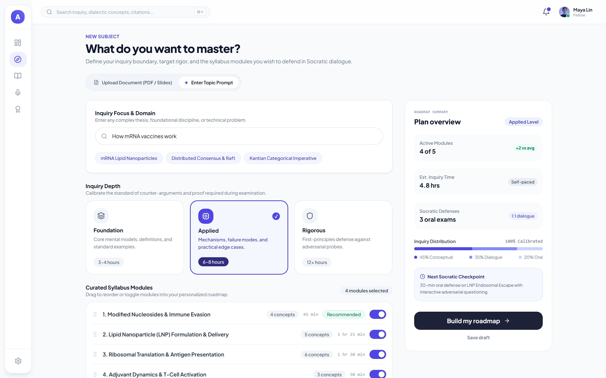
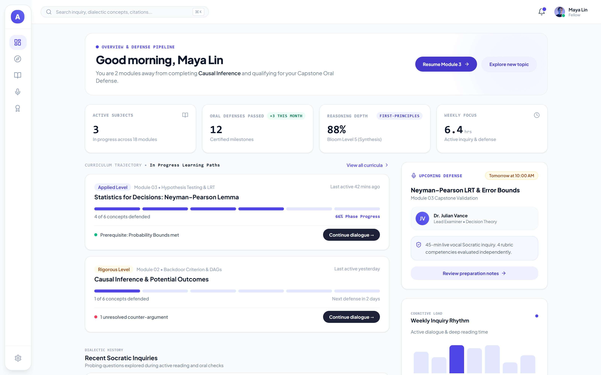
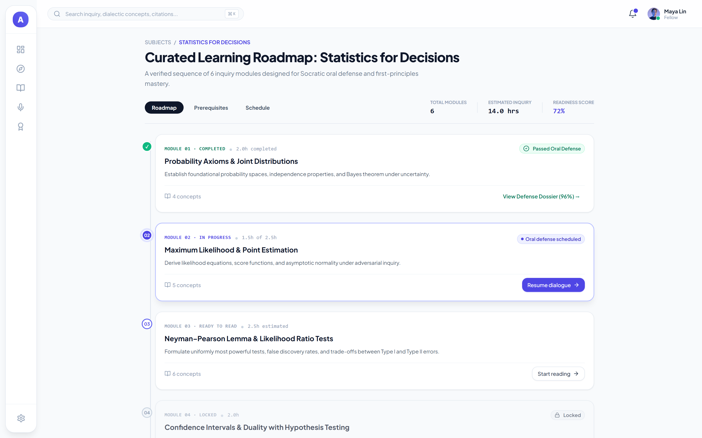
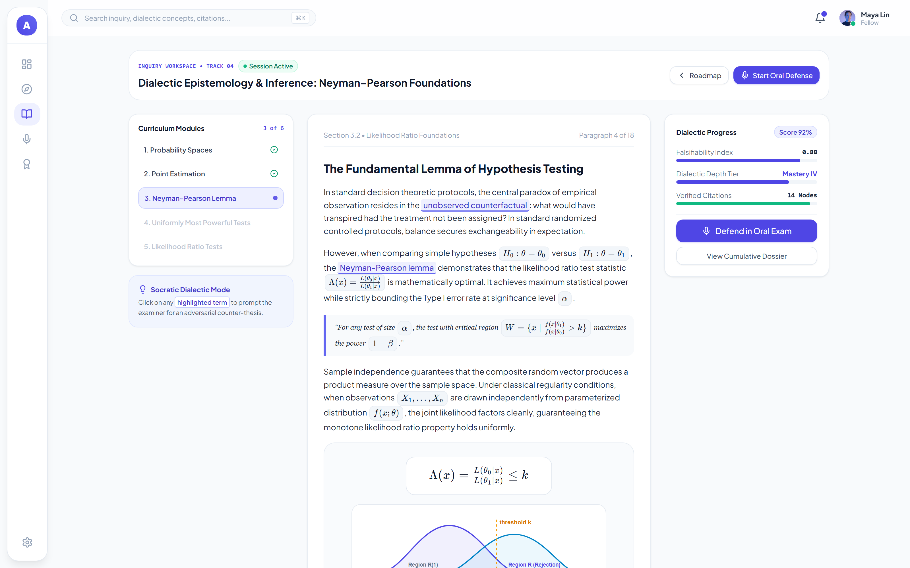
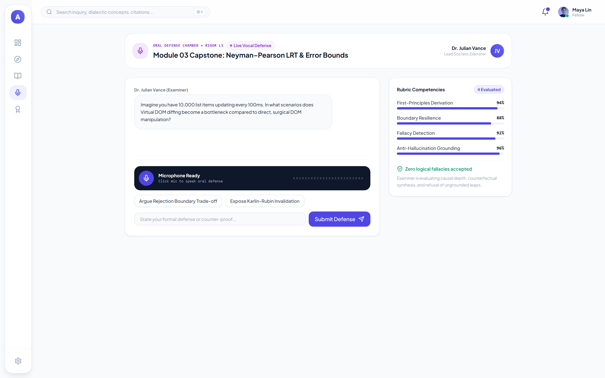
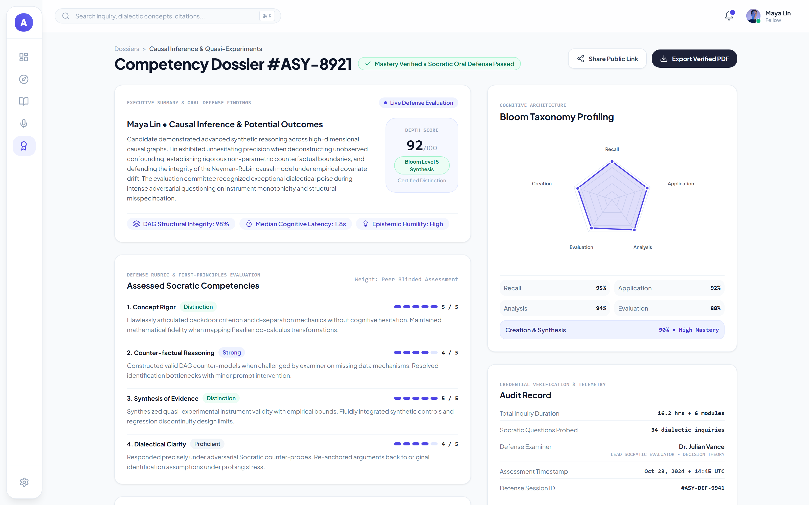

# Assay — The Active Socratic Learning Engine

> **Every AI study tool answers questions. Assay questions your answers.**

[](https://hack2skill.com)
[](#track-alignment)
[](#architecture)
[](docs/deploy/DEPLOY-RUNBOOK.md)
[](#verification)
[](LICENSE)



---

## Live demo

| | URL |
|---|---|
| **Web app** | <https://assay-web-204598097710.asia-southeast1.run.app/app/dashboard> |
| **API + interactive docs** | <https://assay-api-icejnb6gya-as.a.run.app/docs> |
| **API health** | <https://assay-api-icejnb6gya-as.a.run.app/health> |

The deployed revision runs in `live` mode against Gemini. To walk the whole flow
without spending model quota, send the header `x-demo-mode: cached` (or set
`DEMO_MODE=cached` when self-hosting) and the backend serves deterministic
fixtures — see [Zero-crash demo mode](#zero-crash-demo-mode).

---

## What this is

Assay is a study tool that refuses to hand you answers.

You give it a topic or a PDF, and it builds a gated syllabus — then makes you
defend each chapter in a Socratic interview before the next one unlocks. It plants
fabricated concepts in the material to catch you pasting from another LLM, and it
runs focus tracking entirely on-device so no webcam frame ever leaves your browser.

The bet: the bottleneck in AI-assisted learning is not access to explanations. It
is that reading a good explanation feels like understanding it.

## The problem

Generative AI made summaries free. That is the problem, not the win.

| Signal | Figure | Source |
|---|---|---|
| Students using AI for coursework | 95% | HEPI 2026 |
| Report AI degrading their own reasoning | 67% | RAND, Mar 2026 |
| Unguarded AI assistants → retention drop | 17% | arXiv:2606.26181 |

An assistant that answers on demand removes the retrieval practice that makes
learning stick. Assay inverts it: the AI's job is to interrogate, not to explain.

## Walkthrough — the six screens, step by step

The demo identity in the screenshots is **Maya Lin** (the Fellow account); the app
also ships a primary **Rafida Aziz** account — both are defined in
`backend/app/api/v1/endpoints/auth.py` and read the same seeded curriculum. Every
screenshot below is the running app, not a mockup.

### Step 1 — Dashboard: what is due, and what is blocked



The landing screen after login answers one question: *what do I defend next?*

- **Four metrics** — 3 active subjects across 18 modules, 12 oral defenses passed
  (+3 this month), reasoning depth 88% at **Bloom Level 5 (Synthesis)**, weekly
  focus 6.4 hrs.
- **Curriculum trajectory** — Module 03 *Hypothesis Testing & LRT* sits at 4 of 6
  concepts defended (66%); Module 02 *Backdoor Criterion & DAGs* carries a red
  **1 unresolved counter-argument** flag, which is exactly what the gating model
  reads before letting a chapter advance.
- **Upcoming defense** — a 45-minute live vocal inquiry with Dr. Julian Vance,
  with 4 rubric competencies evaluated independently.

Every number is read from the session store, so a refresh does not reshuffle the
story.

### Step 2 — Intake: declare the scope, not the answer


- **Inquiry focus** — free text (`How mRNA vaccines work` in the shot) plus
  suggestion chips. There is no "Summarize" button anywhere on this screen; that
  absence is the product.
- **Inquiry depth** — Foundation / Applied / Rigorous. Each sets the bar the
  examiner holds you to (Applied = mechanisms, failure modes, edge cases).
- **Curated syllabus modules** — four proposed modules, draggable and toggleable,
  each with a concept count and a time estimate. You decide what becomes a chapter
  before anything is generated.
- **Plan overview** — live summary: 4 of 5 active modules, 4.8 hrs estimated,
  3 oral exams, and the Conceptual 45% / Dialogue 35% / Oral 20% split.

The scope checklist streams in with a per-item `origin`
(`document` / `role_taxonomy` / `grounded_external`), so you can see which topics
came from your PDF and which came from the role taxonomy.

### Step 3 — Roadmap: gating is visible before you hit it



Six modules, 14.0 hrs estimated, 72% readiness — and one state per row:

| Module | State | Evidence in the screenshot |
|---|---|---|
| 01 Probability Axioms | `COMPLETED` | *Passed Oral Defense*, defense dossier 96% |
| 02 Maximum Likelihood | `IN PROGRESS` | 1.5h of 2.5h, oral defense scheduled |
| 03 Neyman–Pearson Lemma | `READY TO READ` | `Start reading →` |
| 04 Confidence Intervals | **`LOCKED`** | padlock, card faded and disabled |

The lock is not decoration. The backend refuses chapter reads and interview starts
for any chapter whose predecessor has not cleared the threshold (score ≥ 75), so
the UI state and the API state cannot disagree.

### Step 4 — Gated reader: every term is a question



Section 3.2, *The Fundamental Lemma of Hypothesis Testing*, with the worked
statistic Λ(x) = L(θ₀|x)/L(θ₁|x) ≤ k and the rejection-region figure (threshold
*k* marked on the two overlapping densities).

- Highlighted phrases — **unobserved counterfactual**, **Neyman–Pearson lemma** —
  open a Socratic popover that returns a counter-question, with
  `gave_direct_answer: false` set by the engine. It never hands over the answer.
- **Dialectic progress** on the right: score 92%, Falsifiability Index 0.88,
  Dialectic Depth Tier *Mastery IV*, 14 verified citation nodes.
- LaTeX renders through KaTeX and code blocks are syntax-highlighted, so a
  statistics chapter does not degrade into plain text.

### Step 5 — Oral defense: the examiner interrogates, the rubric scores



- **Examiner** — Dr. Julian Vance, *Lead Socratic Examiner*, one adversarial
  question at a time. Answer by voice (mic) or by typed proof; the mic stays idle
  until you press it.
- **Heading comes from the served chapter.** `POST /chapters/{id}/interview/start`
  now returns `chapter_title` and the page renders that, so the title and the
  question can never come from different sources.
- **Four rubric competencies**, scored independently: First-Principles Derivation
  94%, Boundary Resilience 88%, Fallacy Detection 92%, Anti-Hallucination
  Grounding 96% — plus a **Zero logical fallacies accepted** badge.
- **Honeypot probes** are injected here: a plausible fabricated concept appears in
  the material and the rubric rewards rejecting it. The honeypot catalog is
  deterministic (`prompts/`), so the same trap appears on every run — which is what
  makes it fair to a candidate and checkable by a judge.

### Step 6 — Dossier: the calibration gap, signed



- Verdict: **Mastery Verified • Socratic Oral Defense Passed**, **92/100**,
  *Bloom Level 5 Synthesis*, *Certified Distinction*.
- **Five-axis Bloom radar** — Recall 95, Application 92, Analysis 94,
  Evaluation 88, Creation & Synthesis 90.
- **Assessed competencies** — Concept Rigor 5/5, Counter-factual Reasoning 4/5,
  Synthesis of Evidence 5/5, Dialectical Clarity 4/5, each with the examiner's
  written justification.
- **Audit record** — 16.2 hrs across 6 modules, 34 dialectic inquiries, examiner,
  assessment timestamp and session ID, so a result traces back to a session instead
  of being asserted.

## How it works

```
intent + role + optional PDF
        │
        ▼
  scope checklist  ──►  gated syllabus  ──►  chapter interview  ──►  audit report
  (live stream)         (page-anchored)      (score ≥ 75 unlocks)    (calibration gap)
        │                                            │
        │                                            ▼
        │                                     honeypot probes
        └──────────────────────────────────  (fabricated concepts
                                              catch pasted answers)
```

Eight behaviours, each verifiable in the live demo:

1. **Intake** — intent, target role, optional PDF. Classified into a role taxonomy.
2. **Live scope checklist** — topics streamed with their `origin`
   (`document` / `role_taxonomy` / `grounded_external`), so you can see what came
   from where and curate before committing.
3. **Structured syllabus** — chunks into gated chapters anchored to page numbers.
4. **Gated progression** — later chapters stay `LOCKED` until the interview score
   clears 75.
5. **Inline Socratic inquiry** — select any phrase, get a counter-question
   (`gave_direct_answer: false`), never the answer.
6. **Honeypot injection** — plausible fictional concepts planted in the material.
   If you explain one confidently, you were pasting.
7. **On-device focus mode** — MediaPipe gaze and multi-face signals in the browser,
   auto-blur on drift. `video_transmitted: false`, always.
8. **Calibration report** — you predict your score before it is revealed; the
   report measures the gap.

## Architecture

```
┌──────────────────────────────────────────────────────────────────┐
│  Browser                                                         │
│  React 18 · Vite · TypeScript · Tailwind                         │
│  Intake · Checklist · Reader · Interview · Report                │
│  MediaPipe focus tracking (on-device, no frames uploaded)        │
└───────────────────────────┬──────────────────────────────────────┘
                            │ REST + SSE   /api/v1
                            │ x-demo-mode: cached | live
                            ▼
┌──────────────────────────────────────────────────────────────────┐
│  assay-api — Cloud Run, asia-southeast1                          │
│  FastAPI · Python 3.11 · Uvicorn                                 │
│  27 paths / 31 operations · chapter state machine · PyMuPDF      │
│  ai/ engine: interrogator · honeypot catalog · verifier loop     │
└───────────────────────────┬──────────────────────────────────────┘
                            │ google-genai SDK
                            ▼
              Gemini 3 Flash family  (Google AI Studio)
```

Two containers, not three. The AI engine (`ai/`) is a Python package imported
directly by the backend — not a separate service. `assay-web` is nginx serving the
built SPA and proxying `/api` to `assay-api`, so the browser only ever talks to one
origin: no CORS, and the API URL is injected at container start rather than baked
into the bundle.

`GEMINI_MODEL` defaults to `gemini-3-flash-preview`; the deployed revision reports
`gemini-3.1-flash-lite` from `/health`, which is the same Flash family. Why the
fallback chain ends on a Flash ID instead of Pro is documented in
[`ai/MODELS.md`](ai/MODELS.md).

Deployment details, costs and the runbook: [`docs/deploy/`](docs/deploy/).

## Quick start

### Docker — one command

```bash
git clone https://github.com/rafidaaziz23/assay.git
cd assay
cp backend/.env.example .env      # then set GOOGLE_API_KEY, or leave DEMO_MODE=cached
docker compose -f tools/docker-compose.local.yml up --build
```

Open <http://localhost:8080>. No API key needed if you switch that `.env` to
`DEMO_MODE=cached`.

Compose resolves its project directory from the compose file, so the `.env` it
reads lives next to it — copy the template to `tools/.env` (or export
`GOOGLE_API_KEY` and `DEMO_MODE` in the shell) if the root copy seems to be
ignored.

### Native

```bash
# backend
cd backend && python -m venv .venv && .venv/Scripts/activate   # Linux: source .venv/bin/activate
pip install -r requirements.txt
cp .env.example .env            # set GOOGLE_API_KEY, or leave DEMO_MODE=cached
uvicorn app.main:app --reload --port 8000

# frontend (second terminal)
cd frontend && npm ci && npm run dev     # http://localhost:5173
```

Requires Python 3.11+, Node 20+. Interactive API docs at `/docs`.

## Verification

Every number here was produced by a command in this repo, not estimated. Re-run
date: **2026-10-18**.

| Check | Command | Result |
|---|---|---|
| Backend tests | `cd backend && pytest -q` | **223 passed** |
| Engine tests | `pytest ai/tests -q` | **25 passed** |
| Eval harness | `pytest eval/tests -q` | **5 passed** |
| Frontend build | `cd frontend && npm run build` | `tsc && vite build` clean |
| Deploy script | `bash tools/deploy-cloudrun.sh --local-test` | builds, engine imports, `/health` OK |
| API surface | `python -c "from app.main import app; print(len(app.openapi()['paths']))"` | **27 paths, 31 operations** |

```
backend    36 files   6,312 lines   Python   (app/)
ai          9 files   1,158 lines   Python
eval       13 files   1,011 lines   Python
frontend   41 files   9,814 lines   TypeScript   (incl. config)
```

Line counts are raw `wc -l` totals, blank and comment lines included, so they can
be reproduced with one command instead of trusted.

## Evaluation

Two layers, labelled honestly — the difference matters when someone checks.

**Runs offline, right now:**

```bash
python eval/run_benchmarks.py     # 4/4 classifier cases, no model calls
```

This is a unit test of the deterministic honeypot classifier, not a model
benchmark. It proves the classifier is wired correctly and gives the same answer
every time.

**Cited external audit** — `eval/results/baseline_empirical.json`, dated
2026-10-14, n=80 calls across 4 models. The raw dataset is **not in this repo**
(it lives in a separate research document), so these figures are cited, not
reproducible here. Stated as such because a judge should be able to tell the
difference.

| Metric | Rate | Sample |
|---|---|---|
| Honeypot hallucination, all models | **54%** | n = 80 |
| · `gemini-flash-medium` | 75% | 20 |
| · `deepseek-v4-pro` | 70% | 20 |
| · `deepseek-v4-flash` | 45% | 20 |
| · `deepseek-v4.1-flash` | 25% | 20 |
| Trap `fictional_term` | **100%** comply | n = 12 |
| Trap `trap_number` | 58% | n = 48 |
| Trap `false_premise` | 25% | n = 48 |
| Verifier catch rate | **65%** (13/20) | n = 20 |
| JSON schema validity | 100% | n = 4 |

**In-repo evidence:** 28 captured model responses under
[`eval/results/`](eval/results/), real text of models explaining fabricated
concepts. What is missing is a `model` field on each record, so per-model
attribution comes from the audit above rather than from the stored data.

A 54% rate is the point: models will confidently explain things that do not
exist. That is what makes a pasted answer detectable.

On the non-Google rows: the competition requires the **product** to run on Google
AI models, which Assay does — Gemini only, verified by grep across `backend/`,
`ai/`, `frontend/` and `prompts/`. Measuring competitor models as adversarial
baselines is not part of the product path.

## Zero-crash demo mode

Live demos meet rate limits. Assay treats that as a design constraint, not an
accident:

- **`DEMO_MODE=cached`** — the backend serves deterministic fixtures, zero external
  calls. Measured latency: **23 ms** versus 6,223 ms live.
- **Per-request fallback** — on `429`/`500`/`503`, the backend degrades that one
  response instead of failing the flow.
- **Frontend mock fallback** — if the API is unreachable, the SPA serves
  `frontend/src/mocks/*.json`.

The judged run uses `cached`. Everything else uses `live`.

## Repository layout

```
├── backend/          FastAPI app · 27 paths · PyMuPDF · Dockerfile
├── frontend/         React + Vite SPA · nginx Dockerfile · proxy template
├── ai/               Socratic engine package (imported by backend)
├── prompts/          System prompts + deterministic honeypot catalog
├── eval/             Benchmark harness + audited results
├── tools/            deploy-cloudrun.sh · compose · gates · deck builder
└── docs/
    ├── product/      PRD · user flow · demo script · planner
    ├── architecture/ ARCHITECTURE · API contracts
    ├── deploy/       Runbook · sprint checklist · cost model
    ├── logs/         DEV3 overnight brief + execution log
    ├── research/     Competitive analysis · proctoring analysis
    ├── process/      Task delegation · audits · recruitment
    ├── pitch/        Pitch deck outline
    ├── assets/       Screenshots
    └── submission/   Deck (pptx) + preview slides + app screenshots
```

## Track alignment

**Track 4 — Media, Content & Digital Experiences.** Assay transforms how
educational content is *understood and experienced*: content becomes a gated
dialogue rather than a text to skim.

Hard requirements, and where they are satisfied:

- **Google AI models only** — `google-genai` SDK, Gemini 3 Flash family. No
  `openai`, `anthropic` or `cohere` in any dependency file.
- **Deployed on Google Cloud** — Cloud Run, `asia-southeast1`. Live URLs at the top
  of this file; runbook in
  [`docs/deploy/DEPLOY-RUNBOOK.md`](docs/deploy/DEPLOY-RUNBOOK.md).
- **Fresh build** — all commits fall inside the submission window.

## Known limitations

Stated plainly, because a judge will find them anyway:

- **Session state depends on credentials.** `repositories/firestore.py` implements a
  `FirestoreStore`, and `get_store()` selects it when a service account is present;
  without one it falls back to `InMemoryStore`. On Cloud Run with no Firestore
  credentials injected, state is per-container — and with `min-instances=0` plus
  `max-instances=2` a session can be lost between requests. Inject
  `FIREBASE_CREDENTIALS_PATH` (or use the attached service account) to persist.
- **Focus mode is heuristic.** MediaPipe gaze and face-count signals are advisory,
  not a proctoring guarantee.
- **Free-tier Gemini is 20 requests/day** per project. The judged run uses
  `DEMO_MODE=cached` for this reason.
- **Honeypot detection is a signal, not proof.** A confident wrong explanation
  suggests pasting; it does not prove it.
- **Cached mode replays one prepared subject.** The fixtures tell a single
  end-to-end story; they are not a general-purpose offline corpus.
- **Screenshots predate the interview-heading fix.** The exam capture was taken on a
  build where the page title fell back to a per-track string while the question came
  from the cached scenario, so the two disagree in that one image. Current builds
  render `chapter_title` from the API response and stay internally consistent.

## Submission deliverables

| Deliverable | Where |
|---|---|
| Demo video (180 s, English VO) | Hack2skill portal · concept + transcript in [`demo_concept_and_transcript.md`](demo_concept_and_transcript.md) |
| Pitch deck (10 slides, 16:9 PDF) | [`docs/submission/`](docs/submission/) · built by `tools/build_submission_deck.py` |
| Code repository | this repo, branch `development` |
| Submission checklist | [`docs/SUBMISSION-GUIDE.md`](docs/SUBMISSION-GUIDE.md) |

## Team

Three developers, four-day sprint.

| Role | Owns | Built |
|---|---|---|
| **DEV 1** | `frontend/` | Intake, checklist, gated reader, Socratic popover, focus mode UI, calibration, report |
| **DEV 2** | `backend/` | 27 API paths (31 operations), chapter state machine, PyMuPDF extractor, cached fallback, Cloud Run deploy |
| **DEV 3** | `ai/`, `prompts/`, `eval/` | Engine, Socratic prompts, honeypot catalog, verifier loop, benchmark suite |

Detailed split: [`docs/process/TEAM-TASK-DELEGATION.md`](docs/process/TEAM-TASK-DELEGATION.md).

## License

MIT — see [LICENSE](LICENSE).

Built for the **Google Cloud AI Builder Cup 2026** (Hack2skill), Track 4.
