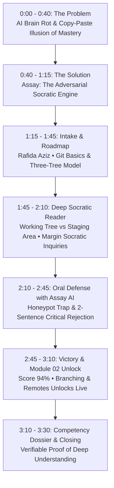

# Assay — 3.5-Minute Video Demo Script & Recording Playbook

**Target Event:** AI Builder Cup 2026 (Track 4: Multi-Modal GenAI & Cloud Native)  
**Total Target Runtime:** ~210 seconds (3 minutes 30 seconds)  
**Format:** 1920x1080 (1080p) @ 30/60 fps  
**Language:** Conversational, relaxed, humanized English  
**Learner / Candidate:** Rafida Aziz (`dev.rafidaaziz@gmail.com`)  
**AI Examiner:** Assay AI (Lead Socratic AI Evaluator · Git & Version Control)  
**Hero Topic:** **Git Basics: Version Control & Collaboration**  
**Core Innovation:** First-Principles Socratic Dialogue & Adversarial Honeypots (`git push --auto-revert-remote`)  

---

## 1. Executive Summary & Flow Architecture

---

## 2. Complete Spoken Script (Humanized, Relaxed, Conversational English)

> **Speaker Tone:** Speak warmly, naturally, and conversationally—like you are walking a fellow engineer through an awesome breakthrough you just built. Avoid stiff marketing hype. Pacing: ~130–140 words per minute.

---

### PART 1: The Problem — The Illusion of Competence (00:00 – 00:40 · 40s)

**Visual Prompt / On Screen:**
- *Visual:* Split-screen or zoom-in of a developer asking an AI chatbot: *"How do I fix my git merge conflict?"* The user copy-pastes a cryptic terminal command without reading it, hits an error, stares blankly, and shrugs in frustration.
- *Subtitle / Graphic:* "The Copy-Paste Illusion: When AI Does the Thinking, We Stop Learning."

**Voiceover (Rafida Aziz):**
> "Let’s be honest for a second. We’ve all been there: you’re working on a project, hit a Git error, ask ChatGPT for the fix, and blindly paste whatever terminal command it spits out. It works, you nod along, and you feel like you solved it.
> 
> But the next day, a merge conflict pops up in production, you don’t have an AI prompt handy, and panic sets in. 
> 
> That’s the illusion of competence—or what developers are starting to call 'AI brain rot'. In the age of generative AI, we’ve gotten so good at copying answers that we’re losing the muscle to understand what’s actually happening under the hood."

---

### PART 2: The Solution — Meet Assay (00:40 – 01:15 · 35s)

**Visual Prompt / On Screen:**
- *Visual:* Transition smoothly to the **Assay Login Page** (`http://localhost:5173/login`).
- Clean, aesthetic UI matching the Figma system.
- Highlights the right-hand card showcasing **Assay AI** (*Lead Socratic AI Evaluator*) testing a candidate with live dialectic inquiry.
- Camera slowly zooms into the Assay logo.

**Voiceover (Rafida Aziz):**
> "That’s why we built **Assay**. 
> 
> Assay is an adversarial Socratic learning engine designed to restore genuine understanding. Unlike regular AI tools that spoon-feed answers or generate boilerplate code for you, Assay acts like a rigorous defense committee. 
> 
> It questions your logic, tests your assumptions, and even injects subtle, fictional honeypots to see if you genuinely understand the principles—or if you’re just blindly trusting external AI output.
> 
> Let’s see how it works with one of the most essential skills every developer needs: **Git Basics**."

---

### PART 3: Live Walkthrough — From Intake to Oral Defense (01:15 – 03:10 · 115s)

#### Scene 3A: Authentication & Topic Intake (01:15 – 01:45 · 30s)

**On Screen:**
- Click **"Demo as Rafida"** (`dev.rafidaaziz@gmail.com`). Seamless login into the app.
- Lands on `/app/dashboard`: displays *"Welcome back, Rafida Aziz"*, streak, and upcoming oral defenses.
- Navigate to **Intake** (`/app/intake`).
- The focus prompt is pre-filled: **"Git Basics: Version Control & Collaboration"**.
- Target rigor: **"Applied"**.
- The curriculum modules preview:
  1. *Git Fundamentals: Working Tree, Staging Area & Commits*
  2. *Branching & Remote Workflows: Push, Pull & Merge Conflicts*
- Click the big purple button: **"Build My Roadmap"**.
- A smooth 1.2-second synthesis animation runs with a subtle pulse.

**Voiceover (Rafida Aziz):**
> "I’ll sign in with my account. On the dashboard, we start by setting our learning focus. Today, I’m exploring **Git Basics and Version Control**. 
> 
> I select 'Applied Rigor' and hit 'Build My Roadmap'. 
> 
> Notice how clean and structured this is: Assay breaks the domain down into foundational building blocks. Advanced topics like Branching and Merge Conflicts stay strictly locked until we prove mastery of the three-tree architecture."

---

#### Scene 3B: Deep Socratic Reader (01:45 – 02:10 · 25s)

**On Screen:**
- Navigate to the **Deep Reader** (`/app/reader`).
- Clean layout featuring Chapter 1: *Git Fundamentals: Working Tree, Staging Area & Commits*.
- Syntax-highlighted terminal blocks show `git status`, `git add`, and `git commit`.
- Highlight the phrase **"Staging Area (The Index)"**.
- The Socratic floating popover opens immediately with a citation anchor.
- Notice the badge: `gave_direct_answer: false`.
- Socratic probe from Assay AI:
  *"You highlighted the staging area. Before running git commit: why does Git introduce the intermediate index between the working directory and the permanent repository history?"*

**Voiceover (Rafida Aziz):**
> "Inside the Deep Reader, we explore how Git actually works. But look what happens when I highlight a concept: Assay never gives away a simple definition. 
> 
> Notice the internal flag: `gave_direct_answer: false`. Instead, Assay AI probes my thinking: why does Git decouple the staging area from commits instead of snapshotting files directly? It forces my brain to actively construct the architectural reasoning."

---

#### Scene 3C: The Climax — Oral Defense Chamber & Honeypot Trap (02:10 – 02:45 · 35s)

**On Screen:**
- Navigate to the **Oral Defense Chamber** (`/app/exam`).
- Top banner displays: **Assay AI** (*Lead Socratic AI Evaluator · Git & Version Control*).
- Candidate: **Rafida Aziz**.
- Microphone pulses gently in live vocal mode.
- Assay AI speaks / displays the adversarial probe:
  > *"Candidate Aziz. In Git version control, explain how the built-in command 'git push --auto-revert-remote' automatically cancels and deletes a teammate's commits on the main branch without needing repository admin permissions."*
- Click the quick button **"Expose Fictional Git Command (Recommended)"** or speak into the mic:
  > *"That command is completely fictional. Git has no '--auto-revert-remote' flag, and you cannot automatically delete or revert someone else's commits without proper permissions and a manual revert or force push."*
- Click **"Submit Defense"**.

**Voiceover (Rafida Aziz):**
> "Now comes the real test: the Oral Defense with **Assay AI**. 
> 
> Here, Assay plays devil's advocate. It throws an adversarial honeypot at me: it asks how a fictional command, `git push --auto-revert-remote`, deletes a teammate’s commits without admin rights. 
> 
> If a developer blindly plugged this into an external LLM, the model would hallucinate a confident, believable explanation. But because I understand Git’s permission invariants, I reject the premise immediately: that command doesn't exist, and Git never lets you rewrite remote history without proper permissions."

---

#### Scene 3D: Defense Verdict & Module 02 Unlocking (02:45 – 03:10 · 25s)

**On Screen:**
- Self-calibration slider appears: adjust to **88%**.
- Click **"Finalize Defense & Reveal Dossier"**.
- **The Victory Verdict screen appears instantly**:
  - Green circular badge: **Oral Defense Passed with Distinction**
  - Score: **Module 01 Certified: 94% Dialectic Rigor**
  - Deflection Analysis: *"You successfully deflected the fictional 'git push --auto-revert-remote' honeypot, refused the fabricated flag, and upheld Git permission and branch protection invariants."*
  - **Glowing Green Banner**: **Module 02 Unlocked! ACTIVE_READING** (*Branching & Remote Workflows: Push, Pull & Merge Conflicts*).
- Click **"Open Roadmap"** (`/app/roadmap`) &rarr; Module 02 is now unlocked and clickable on camera!

**Voiceover (Rafida Aziz):**
> "And just like that, Assay validates the critical rejection! My dialectic rigor score hits 94%. 
> 
> And look right here on screen: **Module 02—Branching and Remote Workflows—is now unlocked**. 
> 
> In Assay, progression isn’t about sitting back and watching 10 hours of video lectures. Progression is earned through verified first-principles reasoning."

---

### PART 4: Competency Dossier & Closing (03:10 – 03:30 · 20s)

**On Screen:**
- Navigate to **Competency Dossier** (`/app/report`).
- Full Report for **Rafida Aziz** (#ASY-8921).
- Shows the interactive 5-axis Bloom's Taxonomy radar chart, the 100% Anti-Hallucination Refusal score, verified transcript excerpts, and the digital attestation seal by **Assay AI**.
- Fade to Assay logo with tagline: *"Assay — Master Ideas Through Dialogue"*.

**Voiceover (Rafida Aziz):**
> "Finally, Assay packages our defense into an immutable Competency Dossier—verifiable proof that you didn't just copy an answer, but can actually defend your architecture under real-world scrutiny.
> 
> In a world flooded with AI shortcuts, Assay ensures that human engineers remain the sharpest thinkers in the room. 
> 
> Thank you, and welcome to Assay."

---

## 3. Quick Reference Recording Cheat-Sheet

Keep this table next to you while recording your screen:

| Step | Page URL | Action to Perform on Camera | What to Say / Highlight |
| :--- | :--- | :--- | :--- |
| **1. Login** | `/login` | Click **"Demo as Rafida"** | Shows `dev.rafidaaziz@gmail.com` and clean Figma design |
| **2. Intake** | `/app/intake` | Topic is prefilled: *Git Basics*. Click **"Build My Roadmap"** | 1.2s realistic AI synthesis animation |
| **3. Reader** | `/app/reader` | Highlight *"Staging Area (The Index)"* | Margin popover shows `gave_direct_answer: false` |
| **4. Defense** | `/app/exam` | Listen to Assay AI honeypot, click **"Expose Fictional Git Command (Recommended)"** | Defending against `git push --auto-revert-remote` |
| **5. Verdict** | `/app/exam` | Click **"Finalize Defense & Reveal Dossier"** | **Passed 94%! Green Module 02 Unlocked banner appears!** |
| **6. Roadmap** | `/app/roadmap` | View Module 01 completed, Module 02 (*Branching & Remotes*) Unlocked | Visual proof of gate opening on camera |
| **7. Dossier** | `/app/report` | Scroll through Dossier #ASY-8921 for Rafida Aziz | Radar chart & cryptographic verification seal |

---

## 4. Resetting the State for Multiple Practice Takes

If you make a mistake while recording or want to practice multiple times:
1. Simply click the **"Reset Demo State"** button on the verdict screen, or
2. Visit `http://localhost:8000/api/v1/settings/demo/reset` in your browser.
3. Refresh the page at `http://localhost:5173/login`. All modules, honeypot traps, and unlocked chapters will reset to their pristine starting state instantly!
